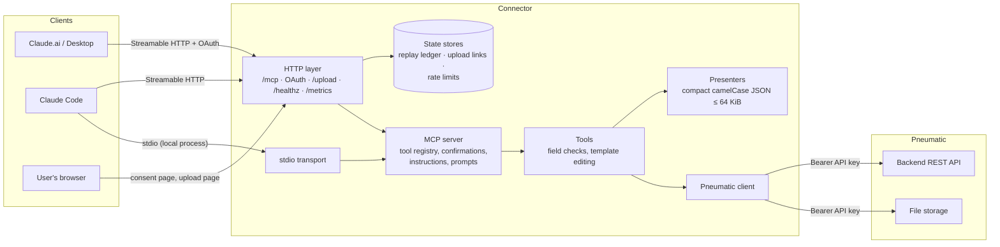
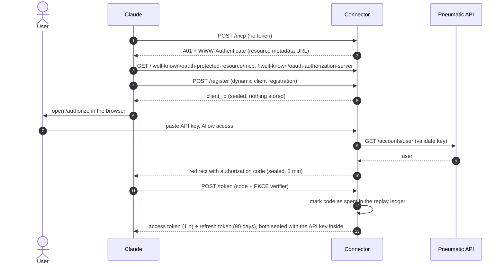
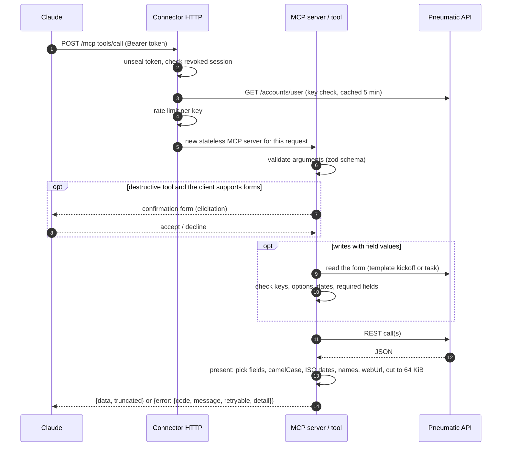
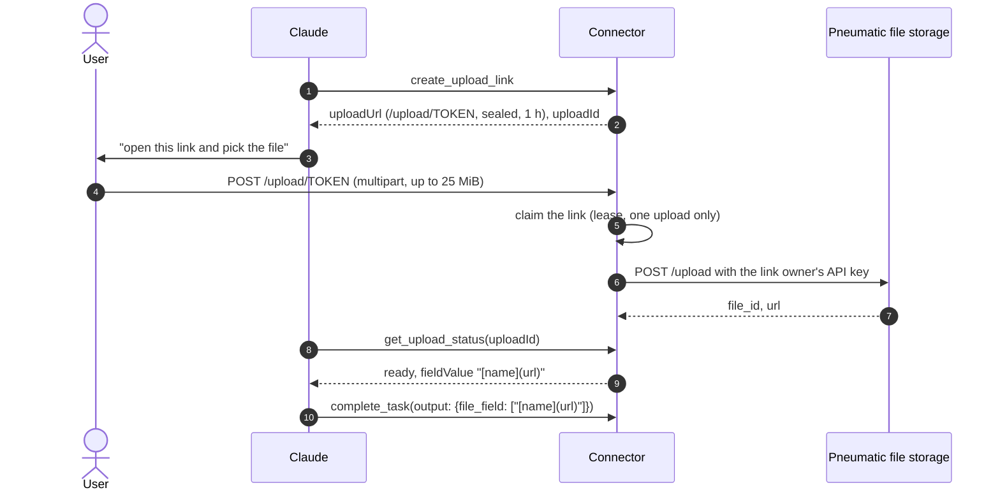

# Pneumatic connector for Claude

An [MCP](https://modelcontextprotocol.io) server that connects Claude to [Pneumatic Workflow](https://github.com/pneumaticapp/pneumaticworkflow): run workflows from templates, work through the task inbox, comment, reassign performers, snooze or return workflows, and pull dashboard numbers — all in plain language.

It runs in two modes:

| Mode                     | Used by                                                                | Auth                                                                                        |
| ------------------------ | ---------------------------------------------------------------------- | ------------------------------------------------------------------------------------------- |
| `http` (Streamable HTTP) | Claude.ai / Claude Desktop custom connector, Claude Code, Messages API | OAuth 2.1 (the user pastes their Pneumatic API key once) or a raw API key as `Bearer` token |
| `stdio`                  | Claude Desktop / Claude Code as a local process                        | `PNEUMATIC_API_KEY` env var                                                                 |

The connector acts with the permissions of the API key owner. Create a key in Pneumatic: **Integrations → Your API Keys → Create** (the Integrations page is visible to admins; the full key is shown only once, right after creation).

**Where to start**

- Host it for a team (Claude.ai, Claude Desktop, remote Claude Code): [docs/DEPLOYMENT.md](docs/DEPLOYMENT.md).
- Try it on your machine: [Claude Code](#claude-code) or [Claude Desktop](#claude-desktop-local-process) as a local process.
- Every setting: [Configuration](#configuration). How the parts fit together: [How it works](#how-it-works).

## Tools

| Area      | Tools                                                                                                                                                                                                                                                                                          |
| --------- | ---------------------------------------------------------------------------------------------------------------------------------------------------------------------------------------------------------------------------------------------------------------------------------------------- |
| Account   | `get_current_user`, `list_users`, `list_groups`, `list_notifications`, `mark_notifications_read`, `set_vacation`                                                                                                                                                                               |
| Templates | `list_templates`, `get_template`, `get_template_kickoff`, `run_workflow`                                                                                                                                                                                                                       |
| Design    | `create_template`, `generate_template_steps`, `update_template`, `add_template_step`, `update_template_step`, `remove_template_step` ⚠, `update_template_kickoff`, `remove_template_fields` ⚠, `clone_template`, `delete_template` ⚠, `list_library_templates`, `create_template_from_library` |
| Workflows | `list_workflows`, `get_workflow`, `list_workflow_events`, `comment_on_workflow`, `update_workflow`, `snooze_workflow`, `resume_workflow`, `return_workflow_to_task` ⚠, `finish_workflow` ⚠, `terminate_workflow` ⚠                                                                             |
| Tasks     | `list_tasks`, `get_task`, `complete_task`, `revert_task` ⚠, `comment_on_task`, `set_task_due_date`, `add_task_performer`, `remove_task_performer` ⚠, `set_checklist_item`                                                                                                                      |
| Files     | `list_attachments`, `download_file`, `upload_file`, `create_upload_link`†, `get_upload_status`†                                                                                                                                                                                                |
| Comments  | `edit_comment`, `delete_comment` ⚠, `react_to_comment`, `list_task_events`                                                                                                                                                                                                                     |
| Reports   | `get_dashboard`, `list_highlights`, `get_template_step_stats`, `count_workflows`, `get_workflow_field_values`                                                                                                                                                                                  |
| Datasets  | `list_datasets`, `get_dataset`, `create_dataset`, `update_dataset` ⚠, `delete_dataset` ⚠                                                                                                                                                                                                       |
| Admin     | `create_user`, `update_user`, `get_assignment_count`, `deactivate_user` ⚠, `reassign_user` ⚠, `create_group`, `update_group` ⚠, `delete_group` ⚠                                                                                                                                               |

⚠ marked with `destructiveHint`. When the client supports MCP elicitation (forms) and the connector can reach it — protocol 2026-07-28, or stdio — the client shows a confirmation with the call's arguments before the connector runs these tools, and nothing changes when the user declines (`cancelled`). Over Streamable HTTP with earlier protocol versions, and with clients without forms, the server instructions tell Claude to confirm with the user first. Read-only tools carry `readOnlyHint`, so clients can auto-approve them.

The server also offers MCP prompts — ready-made scenarios that clients list as commands: `triage_inbox`, `weekly_report` (`days`), `start_process` (`request`), `find_bottlenecks` (`template`), `offboard_user` (`user`, `successor`) and `design_process` (`description`). They only guide Claude through the tools above and ask for confirmation before changes.

Dates are ISO 8601 everywhere: inputs such as `2026-10-15T09:00:00Z` (also in date fields of `complete_task`, `run_workflow` and `update_workflow`) are converted to the Unix timestamps the Pneumatic API expects, and results show dates as ISO 8601 in UTC (`dueDate`, `dateStarted`, ...). Results also include `webUrl` links into the Pneumatic web app (`PNEUMATIC_APP_URL`) and the names of performers, authors and workflow starters next to their IDs (the account's users and groups are cached for 5 minutes per key).

Before `complete_task`, `run_workflow` and `update_workflow` write field values, the connector reads the form and rejects unknown keys (pointing to the right `api_name` when a label was used), options that are not in the field's selections, malformed file links, `string` values over 140 characters and empty required fields, so the model gets a precise message instead of a generic Pneumatic validation error. This costs one extra read per write.

Tool results are compact: `structuredContent` (and the JSON text) is `{data, truncated}` with camelCase keys. It contains only the fields a model needs and is bounded to 64 KiB; `truncated: true` marks shortened text or lists. Lists return `data.items` and `data.page` (`limit`, `offset`, `returned`, `total`, `nextOffset`). Errors return `isError` with `{error: {code, message, retryable, status?, detail?}}`. `detail` carries Pneumatic's own validation message, and failed writes warn that the outcome may be unknown. Arguments that violate the input schema, including unknown keys, are rejected by the MCP SDK with a plain-text error.

Design and admin tools need the API key owner to be an admin (`get_workflow_field_values` needs the account owner). `create_template` takes steps with performers, output fields, checklists and due dates and chains them with start conditions, so steps run one after another unless `sequential: false`. The connected user becomes the template owner. Templates are edited in place: `update_template` (settings, activation, public and embedded forms), `add_template_step`, `update_template_step`, `remove_template_step`, `update_template_kickoff` (adds kickoff fields) and `remove_template_fields` read the template, change only the requested part and send the whole template back, because Pneumatic replaces templates as a whole. Existing api names are kept, and steps chained with "start after the previous step" are re-chained when a step is inserted or removed. Removals are destructive (running workflows lose removed fields and their values) and are refused while anything else in the template still refers to the removed step or field, because Pneumatic does not validate draft templates. `create_user` creates an active user immediately without an invitation email.

`get_template_kickoff` reads the kickoff form through the template list, so template starters and viewers can prepare `run_workflow` without template edit rights.

Files go through the Pneumatic file storage (`PNEUMATIC_FILES_URL`) with the same API key:

- `upload_file` accepts text or base64 (up to 5 MiB) or a public HTTPS URL (up to 25 MiB) and returns `fieldValue`, a `[name](url)` link. Put it into a file field of `complete_task`, `run_workflow` or `update_workflow`, or into a comment.
- File fields in `get_task` / `get_workflow` expose `fileLinks`. Sending a file field replaces its files, so pass the existing links to keep them.
- `download_file` returns images inline, text up to 256 KiB as text and other files up to 3 MiB as base64 resources. Larger files return only metadata and the link.
- † `http` mode only: `create_upload_link` returns a one-time page on the connector (`/upload/<token>`, valid for 1 hour) where the user picks a file from their device (up to 25 MiB). The connector stores it with the same API key; `get_upload_status` then returns `fieldValue`. Links are kept in memory (one process) and only the key that created a link can read its status.

## Production deployment (remote HTTP)

The shared server runs in `http` mode behind a TLS reverse proxy, as **one** Docker container with a persistent volume for the replay ledger. Each user connects with their own Pneumatic API key through OAuth; do not set `PNEUMATIC_API_KEY` on the shared server. [docs/DEPLOYMENT.md](docs/DEPLOYMENT.md) covers requirements, which Pneumatic URLs to set (Cloud and self-hosted), Docker Compose and `docker run` examples, the reverse proxy, upgrades, backups and troubleshooting.

## Claude.ai custom connector (remote)

After deploying, in Claude open **Settings → Connectors → Add custom connector** and enter `https://mcp.example.com/mcp`. Claude opens the Pneumatic consent page; each user pastes their own API key and presses **Allow access**. The connector acts with that key's permissions.

Under the hood Claude discovers OAuth via `/.well-known/oauth-protected-resource/mcp`, registers itself dynamically (`/register`), and runs the authorization code flow with PKCE (`/authorize`, `/token`).

## Claude Code

Remote server with OAuth (a browser window opens on first use):

```bash
claude mcp add --transport http pneumatic https://mcp.example.com/mcp
```

Remote server with a static key:

```bash
claude mcp add --transport http pneumatic https://mcp.example.com/mcp \
  --header "Authorization: Bearer pn-..."
```

Local process:

```bash
npm ci && npm run build
claude mcp add pneumatic --env PNEUMATIC_API_KEY=pn-... -- node /path/to/pneumatic-connector/dist/index.js
```

## Claude Desktop (local process)

`claude_desktop_config.json`:

```json
{
  "mcpServers": {
    "pneumatic": {
      "command": "node",
      "args": ["/path/to/pneumatic-connector/dist/index.js"],
      "env": {
        "PNEUMATIC_API_URL": "https://api.pneumatic.app",
        "PNEUMATIC_API_KEY": "pn-..."
      }
    }
  }
}
```

## Configuration

| Variable                       | Default                                                                               | Description                                                                                                                                                                                                                                                                 |
| ------------------------------ | ------------------------------------------------------------------------------------- | --------------------------------------------------------------------------------------------------------------------------------------------------------------------------------------------------------------------------------------------------------------------------- |
| `MCP_TRANSPORT`                | `stdio`                                                                               | `stdio` or `http` (`--http` / `--stdio` flags override it)                                                                                                                                                                                                                  |
| `PNEUMATIC_API_URL`            | `https://api.pneumatic.app`                                                           | Pneumatic backend URL                                                                                                                                                                                                                                                       |
| `PNEUMATIC_API_KEY`            | —                                                                                     | Required in `stdio` mode                                                                                                                                                                                                                                                    |
| `PNEUMATIC_FILES_URL`          | `https://my.pneumatic.app/files` for the Cloud API, otherwise unset                   | Public Pneumatic file storage URL (`FILE_SERVICE_URL` of the backend, e.g. `https://pneumatic.example.com/files`); without it file tools return `not_configured`                                                                                                            |
| `PNEUMATIC_APP_URL`            | `PNEUMATIC_FILES_URL` without `/files` (`https://my.pneumatic.app` for the Cloud API) | Pneumatic web app URL used for `webUrl` links in results; without it results carry no links                                                                                                                                                                                 |
| `HOST`                         | `127.0.0.1`                                                                           | Bind address in `http` mode (`0.0.0.0` in Docker)                                                                                                                                                                                                                           |
| `PORT`                         | `3000`                                                                                | Port in `http` mode                                                                                                                                                                                                                                                         |
| `PUBLIC_URL`                   | `http://localhost:$PORT`                                                              | Public origin (no path, query or credentials); HTTPS required except on loopback                                                                                                                                                                                            |
| `TOKEN_SECRET`                 | —                                                                                     | Required in `http` mode, at least 32 characters                                                                                                                                                                                                                             |
| `OAUTH_REPLAY_FILE`            | —                                                                                     | Required in `http` mode; path to a persistent writable replay ledger                                                                                                                                                                                                        |
| `OAUTH_ALLOWED_REDIRECT_HOSTS` | `claude.ai,claude.com,localhost,127.0.0.1,[::1]`                                      | Hosts allowed as OAuth redirect targets; `*` allows any                                                                                                                                                                                                                     |
| `RATE_LIMIT_PER_MINUTE`        | `120`                                                                                 | MCP requests per minute per API key in `http` mode; `0` disables the limit                                                                                                                                                                                                  |
| `TRUST_PROXY`                  | `loopback,uniquelocal`                                                                | Express `trust proxy`: `true`, `false`, a hop count or subnets; must match your reverse proxy so client IPs are correct                                                                                                                                                     |
| `TOOLSETS`                     | all                                                                                   | Comma-separated tool groups to offer: `core` (account, templates, workflows, tasks, comments, notifications, vacations, listing users, groups and datasets), `files`, `design` (template editing), `analytics`, `admin` (managing users, groups and datasets, reassignment) |
| `READ_ONLY`                    | `false`                                                                               | `true` offers only read-only tools; the instructions tell Claude to describe changes instead of making them                                                                                                                                                                 |
| `LOG_LEVEL`                    | `info`                                                                                | `debug`, `info`, `warn`, `error` or `off`; JSON lines on stderr; other values are a configuration error                                                                                                                                                                     |
| `METRICS_TOKEN`                | —                                                                                     | In `http` mode enables `GET /metrics` (Prometheus) for `Authorization: Bearer <token>`; at least 16 characters                                                                                                                                                              |

Use `node --env-file=.env dist/index.js` to load variables from a file (see `.env.example`).

## Security model

- The server keeps no credential database. Client registrations, authorization codes, access tokens (1 hour) and refresh tokens (90 days) are AES-256-GCM sealed with a key derived from `TOKEN_SECRET`; the Pneumatic API key travels only inside them. An append-only local ledger stores spent-token identifiers and expirations, never API keys; it is compacted on startup and once at least 10,000 records were written and most of them have expired. A torn last line from a crash is ignored on startup, and after a failed write the next token request rewrites the ledger from memory, so `/healthz` recovers without a restart.
- Rotating `TOKEN_SECRET` invalidates every issued token and client registration.
- Every MCP request re-validates the key against Pneumatic (cached for 5 minutes; rejected keys for 1 minute), so revoking the key in Pneumatic cuts access off. Checks of not-yet-cached keys are capped at 300 per minute per process, so guessing keys through the connector cannot flood Pneumatic; cached keys keep working. The consent form accepts 10 rejected keys per client IP per minute (`TRUST_PROXY` decides which proxy's `X-Forwarded-For` is trusted).
- Authorization codes expire in 5 minutes, and refresh tokens are rotated on use. Replaying an already rotated refresh token more than 30 seconds later revokes the whole session (all its access and refresh tokens); a quick retry of a lost response is only rejected. Both the revocation and the 30-second grace window are recorded in the replay ledger. The durable replay ledger rejects reuse after restarts. It supports **one HTTP process only**; multiple replicas require a shared atomic store. Codes and refresh tokens issued before versioned replay protection are rejected on upgrade, so users must authorize again; existing access tokens remain valid until expiry. PKCE S256 with a 43–128 character verifier is mandatory.
- Confidential OAuth clients registered before authentication-method enforcement must register again. Public clients continue to work.
- Redirect URIs must be HTTPS (HTTP only on loopback) and belong to `OAUTH_ALLOWED_REDIRECT_HOSTS`.
- The API key is sent only to `PNEUMATIC_API_URL` and `PNEUMATIC_FILES_URL`. `download_file` accepts only links under `PNEUMATIC_FILES_URL`.
- `upload_file` with `sourceUrl` fetches only public HTTPS URLs on port 443 without credentials. Every resolved address, including after each of at most 3 redirects, must be public: loopback, private, link-local, metadata and reserved ranges are refused at connect time. Downloads are capped at 25 MiB and 30 seconds and never carry the API key.
- In `http` mode each API key gets `RATE_LIMIT_PER_MINUTE` MCP requests per minute (in-memory, per process); excess requests receive HTTP 429 with `Retry-After`. The file storage has its own per-IP limits (by default 10 uploads and 100 downloads per minute), and on a shared server all users share the connector's IP.

## Operations

- **Toolsets.** A catalog of 68 tools (66 in `stdio` mode, which has no upload links) costs context and makes tool choice harder, so deployments can offer only what their users need: for example `TOOLSETS=core,files` for everyday work and the full set for admins. `READ_ONLY=true` hides every tool that changes data (Pneumatic API keys have no read-only scope of their own).
- **Logs.** Every HTTP request is logged as one JSON line on stderr with a request ID (`X-Request-Id` is accepted and echoed), the route, the status and the duration; every tool call that passes input-schema validation with the tool name, the outcome or error code and the duration (calls rejected by the schema are answered by the SDK and only appear as `http_request` lines). Request errors such as malformed JSON are logged as `http_error` with the route, status and error type. Logs never contain API keys, tokens, upload links, request bodies, tool arguments or results. Health checks and metric scrapes are logged at `debug`. Prompts are offered only when every tool they use is offered, and the instructions mention only offered tools.
- **Metrics.** With `METRICS_TOKEN`, `GET /metrics` exposes `mcp_tool_calls_total{tool,outcome}`, `mcp_tool_call_seconds_total{tool}` (divide by the call count for the mean duration), `http_requests_total{route,status}` and `pneumatic_requests_total{target,method,status}` (status classes of calls to the Pneumatic API and file storage). Counters are per process. `/metrics` skips the `Host` check, so Prometheus can scrape it by container or service name.
- **CI.** `.github/workflows/ci.yml` runs lint, format check, typecheck, tests and build on Node 22 and 24, starts the built server on Node 20.19, 22 and 24 and checks `/healthz` and the 401 on `/mcp`, and builds the Docker image. Pushing a `vX.Y.Z` tag runs `release.yml`, which checks that the tag matches `package.json` and `src/core/version.ts`, tests, and publishes the image to `ghcr.io/<owner>/<repo>` as `X.Y.Z`, `X.Y` and `latest`.
- **Release checks.** [docs/manual-checklist.md](docs/manual-checklist.md) lists what to verify with real clients and a real Pneumatic account before a release.

## How it works

### Components



The connector holds no Pneumatic data. Every request carries the user's API key (sealed inside the OAuth token or passed directly), and Pneumatic enforces permissions. The stores keep only spent-token IDs, pending upload links and rate-limit counters.

### Connecting (OAuth, `http` mode)



With a static key (`Authorization: Bearer pn-...`) or in `stdio` mode this step is skipped.

### Tool call



### File from the user's device (`http` mode)



`upload_file` (text, base64 or a public HTTPS URL) skips the browser step and returns the same `fieldValue`.

## Architecture

The connector translates between MCP and the Pneumatic REST API; Pneumatic owns the business rules. Dependencies point inward only:

| Layer             | Directory                                   | Responsibility                                                                                                                                                                                                                                | May import                       |
| ----------------- | ------------------------------------------- | --------------------------------------------------------------------------------------------------------------------------------------------------------------------------------------------------------------------------------------------- | -------------------------------- |
| Core              | `src/core`                                  | Errors (`ConnectorError`), ports (`RemoteFetcher`, `UploadLinks`, `ReplayStore`, `UploadStore`, `RateLimiter`), JSON guards (`isRecord`, `records`), file and field limits, file header parsing, key hashing, time, logging, metrics, version | nothing                          |
| Pneumatic adapter | `src/pneumatic`                             | REST and storage client (`createPneumaticClient({ apiUrl, filesUrl, appUrl, fetchFn }, apiKey)`, `createClientFactory`), file IDs, SSRF-guarded URL fetch                                                                                     | core                             |
| Stores            | `src/stores`                                | Implementations of the state ports: file replay ledger, in-memory upload links and rate limits                                                                                                                                                | core                             |
| Presenters        | `src/presenters`                            | Bounded JSON projection, pagination, 64 KiB envelope, Pneumatic object presenters                                                                                                                                                             | core                             |
| MCP adapter       | `src/mcp`                                   | `ToolDef` and `tool()`, registration with error mapping, result envelope, server instructions                                                                                                                                                 | core, pneumatic, presenters      |
| Tools             | `src/tools`                                 | Declarative tool definitions per area (`xTools: ToolDef[]`), collected with their toolset in `src/tools/index.ts`; shared schemas, annotations and helpers in `shared.ts`                                                                     | core, pneumatic, presenters, mcp |
| Transports        | `src/http`, `src/index.ts`, `src/server.ts` | stdio, Streamable HTTP, OAuth, upload page; `buildServer` registers the available tools                                                                                                                                                       | everything above                 |

Tools are data: `buildServer` filters the catalog by the transport's capabilities (`requires: 'uploads'` tools exist only in `http` mode), registers them and generates the instructions, including the list of destructive tools that need user confirmation.

State shared by all requests sits behind asynchronous ports in `src/core/ports.ts`: `ReplayStore` (spent codes and refresh tokens, revoked sessions, the refresh-retry grace window), `UploadStore` (upload links; `claim` atomically leases a pending link, and the lease lapses on its own if a process dies) and `RateLimiter` (sliding one-minute window per scope and key). `createHttpApp(config, fetch, stores)` uses the file ledger and in-memory stores by default, which is why one process is required today. Running several replicas means passing implementations backed by one shared store, for example Redis: `SET key NX EXAT` for replay entries, a Lua script (or `WATCH`/`MULTI`) that checks the link and sets `SET lease NX EX` for claims, and a sorted set per key for the sliding window. `test/stores.contract.test.ts` is the suite every implementation must pass; it also runs each store behind a wrapper that delays every call, so callers that check and then act without an atomic operation fail.

## Development

```bash
npm install
npm test          # vitest: tools, OAuth flow and MCP endpoint against a fake Pneumatic API
npm run typecheck
npm run lint
npm run format:check
npm run dev -- --http   # needs TOKEN_SECRET and OAUTH_REPLAY_FILE
```

To add a tool, append a `tool(name, { title, description, inputSchema, annotations }, async (args, { client }) => ...)` entry to the area's array in `src/tools/` and present the response with `Compact` from `src/presenters`. The array's place in `src/tools/index.ts` decides its toolset, so a tool that belongs to another group goes into that group's array. Use `z.strictObject` and the shared fragments from `src/tools/shared.ts` (`id`, `idList`, `limit`, `offset`, `dateTime`, `fieldValues`, `commentText`, `period`) and its helpers (`optionalTimestamp`, `periodQuery`, `requireExactlyOne`, `assignDefined`, `workflowDetail`, `userDetail`, `fetchTemplate`), and pick the annotation that matches the effect (`readOnly`, `additive`, `idempotentUpdate`, `destructive`). Destructive tools are added to the confirmation rule automatically; `test/catalog.test.ts` checks names, metadata and pagination for every tool. Update the Tools table above.

Tool tests run the real server against the fake Pneumatic API in `test/fakePneumatic.ts` through `test/harness.ts`: `connectServer(fake, options)` connects an MCP client (options set `appUrl`, `fetchFn`, `storage: false`, client `capabilities` and server options), `callTool(client, name, args)` returns `isError`, `data`, `error` and the raw content, and `lastBody(fake, path, method)` returns the last request body sent to Pneumatic.

Use `npm run format` to format the repository with Oxfmt. Oxlint checks JavaScript and TypeScript (including imports); `npm run typecheck` also catches unused TypeScript declarations and parameters. The server runs on Node.js 20.19+ or 22.12+; development and tests need Node.js 22.12+ (Vitest 5).

To check read-only routes against a real Pneumatic instance, use an API key from a test account (never commit `.env`):

```bash
node --env-file=.env --import tsx scripts/smoke.ts
```

The smoke test calls ten read-only endpoints, prints only pass/fail, and stops on the first HTTP error. Write operations are covered by a separate script that runs the tools end to end through the MCP layer — it creates a template and a workflow, completes a task with a file, comments, snoozes and resumes, then deletes everything. Run it only with an admin key of a **disposable** account:

```bash
SMOKE_WRITES=yes node --env-file=.env --import tsx scripts/smoke-write.ts
```

A step whose result lacks what the next steps need fails instead of skipping them, so a green run means every step ran. Inspect the MCP server interactively with `npx @modelcontextprotocol/inspector node dist/index.js`.
